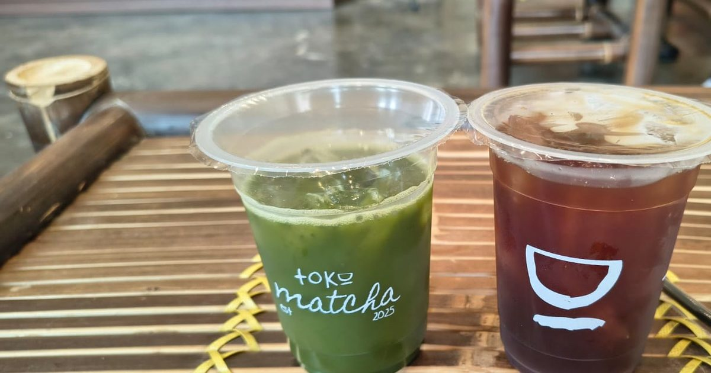

# Toko Matcha

A single-page site for **Toko Matcha**, a matcha shop in Kukusan, Beji, Depok.
It exists to turn an Instagram or TikTok tap into a visit: what the drink looks
like, what it costs, and where the shop is — within one scroll.



## Live site

<!-- Replace once GitHub Pages is enabled -->
https://example.github.io/toko-matcha/

## Running it locally

Everything is static — no build step, no dependencies. But the page must be
served over HTTP rather than opened as a `file://` URL, or the stylesheet and
images will not resolve.

```bash
python -m http.server 8765
```

Then open <http://localhost:8765>.

## Stack

Hand-written HTML, CSS and vanilla JavaScript. No framework, no bundler.
The only external request is the Google Fonts stylesheet (Archivo and
Playfair Display).

- `index.html` — all markup, one page
- `styles.css` — all styling, custom properties at the top
- `script.js` — scroll choreography, the flavour picker, and the mobile menu
- `assets/` — photography and icons
- `DESIGN.md` / `PRODUCT.md` — the design and product thinking behind it

## Notes

- **Motion.** Entrance animations are gated behind a `.js` class on `<html>`,
  so the page still renders fully if JavaScript fails. Everything honours
  `prefers-reduced-motion`, including mid-session changes.
- **Images.** The large photographs are WebP; `width`/`height` are set on every
  `` so nothing shifts as the page loads.
- **Deploying.** Push to GitHub, then Settings → Pages → deploy from `main`.
  Afterwards update the absolute URLs in `rel="canonical"` and the `og:image`
  tag in `index.html`, and the live-site link above — social previews need an
  absolute URL to work.

## License

Source code is MIT (see [LICENSE](LICENSE)). The photographs in `assets/` and
the Toko Matcha name and logo are **not** covered and remain all rights
reserved.
